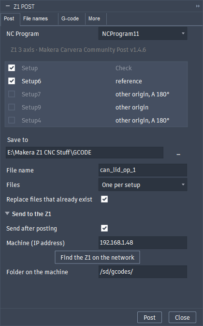
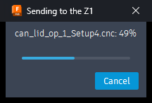
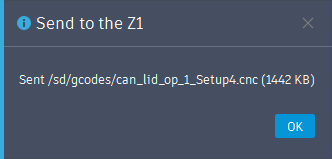
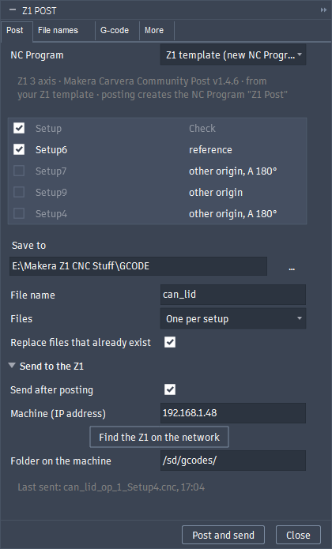
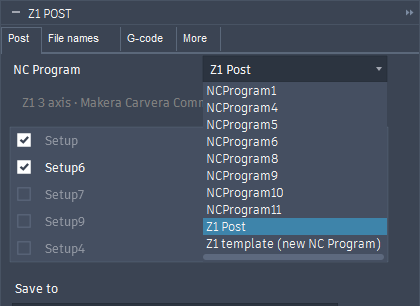
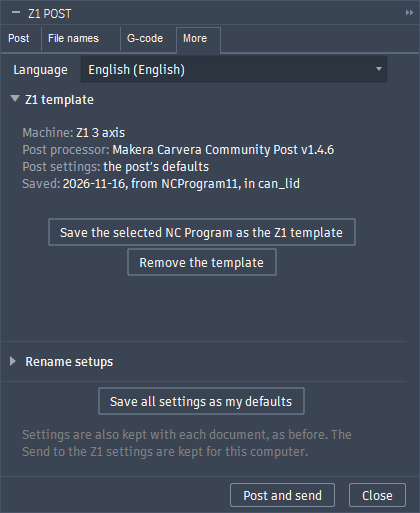
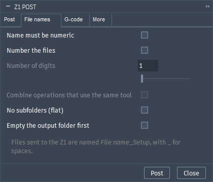
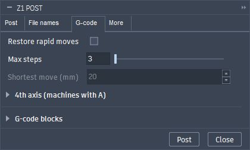

# Z1 Post



A Fusion add-in that post-processes your CAM setups for the **Makera Z1** and **sends the files straight to the
machine over Wi-Fi**. No more saving G-code, copying it to another computer and uploading it again.

- One dialog for a normal post: pick the NC program, tick the setups, press **Post**.
- With **Send after posting** ticked, every file goes to the Z1's SD card as soon as it's written. It shows up
  in Makera Studio's file list, ready to run.
- **No NC Program needed:** save one NC Program as your **Z1 template**, and any document can post straight
  away. Z1 Post creates the NC Program for you.
- Multiple setups in one go, as one file, one per setup, one per tool change or one per operation.
- A-axis rotation between setups for indexed milling, and restored rapid moves (from the original plugin).

Z1 Post is based on the **[Makera Community Fusion plugin](https://github.com/Carvera-Community/Carvera_Community_FusionPlugin)
by Moinois** (version 0.9.1-RC1), used under the GNU GPL v2. All of its post-processing comes from that
project; Z1 Post adds sending to the Z1, reworks the dialog and fixes a few bugs. See [CHANGELOG.md](CHANGELOG.md).

Z1 Post isn't affiliated with or supported by Makera.

<br clear="right">

## Sending to the Z1




- Files are copied to the Z1's SD card with the Z1's own file-transfer protocol on TCP port 2222, the same one
  Makera Studio uses. There's a progress bar with Cancel; a 1.4 MB file takes about 25 seconds.
- **Names on the machine are always `<File name>_<Setup>.cnc`**, flat in the send folder (default
  `/sd/gcodes/`, the folder Makera Studio shows). Spaces become `_`, because Studio doesn't show them. On your
  computer the files are saved the usual way (for example `<File name>/<Setup>.cnc`).
- A file with the same name on the machine is replaced.
- **It won't send while the Z1 is running a job**, and it never touches the file that is playing.
- If the Z1 is off, busy or unreachable, the files are still saved on your computer and the message says why
  they weren't sent.
- It sets the Z1's clock before sending, the way Makera's app does, so the files get the right date.
- **Find the Z1 on the network** listens for the Z1's announcements. If none arrive (Windows Firewall can block
  inbound traffic to Fusion), it asks each address on your local network instead. You can also type the IP.
- The send settings (on/off, machine, folder) are kept for your computer, not per Fusion document, in the
  same place as the Z1 template.

## Z1 template: post without making an NC Program first



Normally you have to run Fusion's own Post Process once in every document, just to create an NC Program that
says which machine and post processor to use. The Z1 template does that for you:

1. In a document that already has a working NC Program for the Z1, open Z1 Post, go to **More → Z1 template**
   and click **Save the selected NC Program as the Z1 template**. It keeps the machine, the post processor and
   the post settings you changed from the post's defaults.
2. In any other document, pick **Z1 template** in the NC Program list (it's selected for you when the
   document has no NC Program yet) and press **Post**.
3. Z1 Post creates an NC Program called **Z1 Post** in that document, using the template, and posts with it.
   It stays in the document (you'll see it in the CAM browser), so next time it's simply selected.

Nothing changes in the document until you press Post. Output folder and file name work as usual; the file
name starts as the document's name.

The template is kept for your computer (with the send settings, in `%APPDATA%\Z1 Post` on Windows or
`~/Library/Application Support/Z1 Post` on a Mac), so updating Z1 Post doesn't lose it. It refers to the
machine and post in your Fusion libraries; on a computer that doesn't have them, the More tab says so and
posting with the template is switched off.




<br clear="right">

## The dialog

| Post | File names | G-code | More |
|---|---|---|---|
|  |  |  |  |

**Post** has everything a normal post needs:
- **NC Program:** the NC program whose machine and post processor are used. The grey line under it names them.
- **Setups table:** tick the setups to post. **Check** says how each setup compares with the first ticked one
  (the *reference*): `OK`, or why it can't be picked, for example `other origin` or `A 180°` (it is turned
  around X, which needs a machine with an A axis and *Rotate A between setups*).
- **Save to** and **File name:** where the files go on your computer.
- **Files:** *One file* (all ticked setups in one file; no pause is added between setups, so only for setups
  that share the stock and zero, or 4th-axis jobs), *One per setup*, *One per setup and tool*, *One per operation*.
- **Replace files that already exist:** remembered, and on by default.
- **Send to the Z1:** see above. The OK button reads *Post and send* when sending is on (as of when the dialog opens).

**File names:** numeric names, numbering the files, combining operations that use the same tool, no subfolders,
and emptying the output folder first (that one is off every time the dialog opens).

**G-code:** restoring rapid moves (Fusion Personal slows rapids down; this finds retract-move-plunge sequences
and turns them back into G0. It's experimental, so check the result in a G-code viewer such as
[NCViewer](https://ncviewer.com)). The closed groups hold the 4th-axis options and the G-code blocks the plugin
looks for.

**More:** the Z1 template (above), language, renaming setups (find and replace, optionally with regular expressions), and **Save all
settings as my defaults** for new documents. Settings are also kept with each document.

## Requirements

- Autodesk Fusion (Windows or Mac).
- An NC program that uses the [Makera Community post processor](https://github.com/Carvera-Community/Carvera_Community_Profiles/tree/main/CAM_Post_Processors)
  (or the post for your machine) and the right machine. Z1 Post runs the post processor for each setup, so
  create the NC program with Fusion's normal Post Process command first.
- For sending: a Makera Z1 with stock firmware on the same network as your computer.

## Installation

1. Download `Z1-Post-vX.Y.Z.zip` from the [latest release](https://github.com/jimmyvegas29/z1-post/releases/latest)
   (from **Assets**, not GitHub's "Source code" archive).
2. Unzip it somewhere permanent. You get a `Z1 Post` folder.
3. In Fusion press **Shift+S** (Utilities → Add-Ins → Scripts and Add-Ins).
4. Click **+** → **Script or add-in from device** and choose the `Z1 Post` folder.
5. Switch **Run** on, and tick **Run on Startup**.

The **Z1** button appears in the Manufacture workspace, under Milling → Actions. Z1 Post can be installed next
to the original Makera Community plugin; they don't share settings or buttons.

To update, replace the folder's contents with the new release and stop and start the add-in (or restart Fusion).

## Development

```bash
python -m pip install -r requirements-dev.txt
python -m pytest
```

The tests need Python 3.14 (the version inside Fusion) and don't need Fusion itself. One test
(`test_clear_removes_files_directories_and_symlinks`) fails on Windows without symlink permission; it does in
the original project too.

A release archive is built with `python scripts/build_release.py --version X.Y.Z`, or by the
**Release** GitHub Actions workflow.

Key files:
- `Z1 Post.py`: add-in entry point.
- `commands/postProcessor/`: the post-processing (from the original plugin).
- `commands/postProcessor/dialog/`: the dialog; `dialog/layout/send_section.py` is the Send to the Z1 group.
- `commands/postProcessor/z1send/`: sending to the Z1. `z1upload.py` is the transfer itself (shared with
  [makera-z1-pendant](https://github.com/jimmyvegas29/makera-z1-pendant)), `send.py` the Fusion progress and
  summary, `naming.py` the names on the machine.
- `commands/postProcessor/z1template/`: the Z1 template (`store.py`, and `template_program.py`, the NC Program
  list entry that creates the real NC Program when you post). The Fusion calls are in
  `fusion_adapters/nc_program_template.py`, the More-tab group in `dialog/layout/template_section.py`.

## Credits and license

- Original plugin: [Makera Community Fusion plugin](https://github.com/Carvera-Community/Carvera_Community_FusionPlugin)
  by Moinois. Its full history is kept in this repository's git log (up to tag `v0.9.1-RC1`).
- The original was inspired by Tim Paterson's [PostProcessAll](https://github.com/TimPaterson/Fusion360-Batch-Post).
- Z1 Post changes by jimmyvegas29, listed in [CHANGELOG.md](CHANGELOG.md); every changed file says so on its
  first line.

Licensed under the **GNU General Public License v2.0**, as the original. See [LICENSE](LICENSE).
